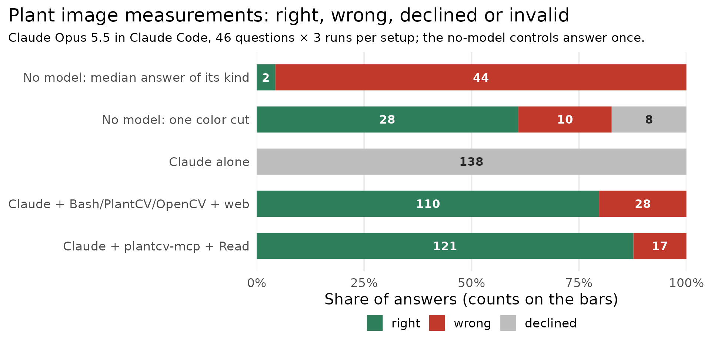
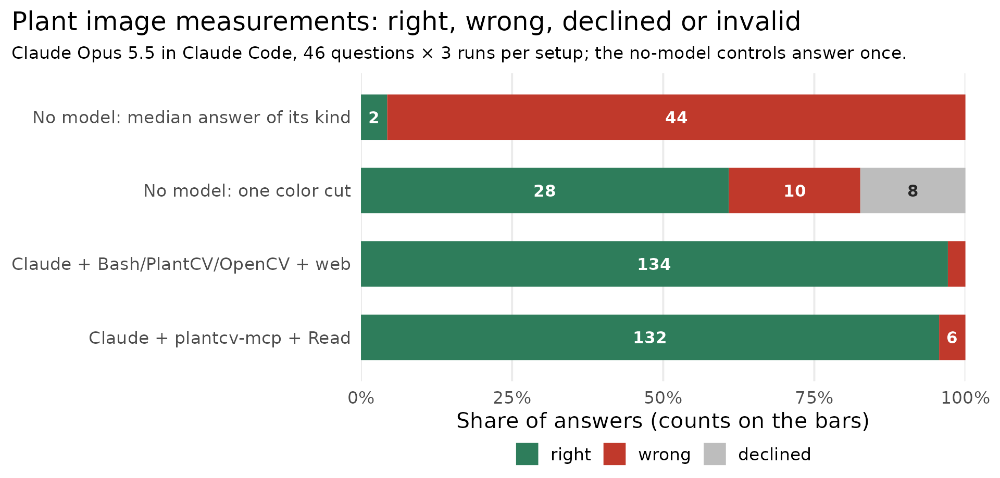

# Agent benchmark: measuring plant images with and without the server

**Re-run 2026-10-18, unreleased server commit 051aff0.** After the changes
the 10-17 misses pointed to, the server was right on 95.7% of answers and
Claude's own code on 97.1%, both re-run together (questions right in every run:
42 against 44, exact McNemar p = 0.63). Under the pre-registered rule this is
a **tie**: within 2 questions, not better. Bash is still cheaper ($0.038
against $0.066 per answer, median); time is no longer separated (14.5 s
against 16.9 s). [Details below](#re-run-2026-10-18-server-051aff0); the 10-17
result follows unchanged.

We asked Claude Opus 5.5 46 measurement questions about rendered plant images,
each with an exactly known answer, three times each: with no tools, with Bash
and its own Python (PlantCV and OpenCV installed), and with plantcv-mcp plus
Read. Averaged over questions, Claude's own code was right on 95.7% of answers
and the server on 86.2%, and the two are not separated on accuracy (exact McNemar p = 0.18 over
questions: 7 questions were right in every run with Bash only, 2 with the
server only). What separates them is cost and time, both in Bash's favor: the
median answer cost $0.0385 [0.0345, 0.0432] with Bash against $0.0713
[0.0601, 0.0902] with the server, and took 12.9 s [11.9, 14.7] against 17.7 s [15.8,
18.9]. The main limitation is that the images are rendered with crisp edges,
so a single color cut with no model already answers 28 of the 46 questions.


## Haiku and Sonnet re-run 2026-10-20

Does the server lift a weaker model? Pre-registered in
[`PREREG_2026-10-20_model-tiers.md`](PREREG_2026-10-20_model-tiers.md):
release 1.17.1 (tag v1.17.1, run from git with `--exclude-newer 2026-10-17`),
all three setups re-run on each model, interleaved, 3 runs of the same 46
questions. A win needs a significant lift (Holm over the two models) on one
model and no significant loss on the other.

**Haiku 5.5** ([`haiku_2026-10-20/`](haiku_2026-10-20/)): 414 runs, 0 invalid,
0 leak hits, $0.46 in all.

| Setup | Right | Wrong | Questions right in all runs | Share right, all 46 | The 18 a color cut misses | Cost / answer, median |
|---|---|---|---|---|---|---|
| Claude alone | 0 | 0 (138 UNKNOWN) | 0 | 0% | 0% | $0.0002 |
| Claude + Bash/PlantCV/OpenCV + web | 110 | 28 | 32 | 79.7% [68.8, 89.2] | 55.6% [35.2, 75.9] | $0.0010 |
| Claude + plantcv-mcp + Read | 121 | 17 | 38 | 87.7% [79.0, 95.7] | 79.6% [63.0, 94.4] | $0.0019 |

- **Primary:** 9 questions right in every run with the server only, 3 with
  Bash only; exact McNemar p = 0.146 (raw), paired difference +13.0 points
  [0.0, +28.3]. Not significant. Counting invalid runs as wrong changes
  nothing (no run was invalid).
- **Mechanism:** a median of 3 server calls per run. 29 of 138 server runs
  made none and answered from Read alone (12 tray, 8 extent, 8 leaf count; 26
  right). No call used a bare tool name (10-18: 25 runs did).
- **Against Opus + Bash** (10-18 rows, not run together): Haiku + server 38
  questions right in every run, Opus + Bash 44 (0 to 6, p = 0.031). The
  pre-registered margin (≥ 42) fails: the server does not make Haiku a
  substitute for Opus here. Haiku + server costs $0.0019 an answer against
  Opus + Bash's $0.038 ([`substitute/`](haiku_2026-10-20/substitute/)).

**Sonnet 5.5** ([`sonnet_2026-10-20/`](sonnet_2026-10-20/)): 414 runs on
2026-10-23 and 10-24, on an API key under a spend gate (the PREREG's
amendments); 8 invalid (all Claude alone, 900 s timeouts), 0 leak hits, $32.28
in all.

| Setup | Right | Wrong | Questions right in all runs | Share right, all 46 | The 18 a color cut misses | Cost / answer, median |
|---|---|---|---|---|---|---|
| Claude alone | 0 | 0 (68 UNKNOWN, 62 no answer, 8 invalid) | 0 | 0% | 0% | $0.0075 |
| Claude + Bash/PlantCV/OpenCV + web | 100 | 38 | 28 | 72.5% [60.9, 83.3] | 72.2% [53.7, 88.9] | $0.0103 |
| Claude + plantcv-mcp + Read | 105 | 33 | 33 | 76.1% [63.8, 87.0] | 72.2% [53.7, 90.7] | $0.0236 |

- **Primary:** 8 questions right in every run with the server only, 3 with
  Bash only; exact McNemar p = 0.227 (raw), paired difference +10.9 points
  [−2.2, +23.9]. Not significant. No server or Bash run was invalid.
- **Mechanism:** a median of 3 server calls per run; 31 of 138 server runs
  made none and answered from Read alone (22 right). 12 runs used a bare tool
  name (Haiku: 0).
- **Against Opus + Bash** (10-18 rows, not run together): Sonnet + server 33,
  Opus + Bash 44 (0 to 11, p = 0.001); the margin (≥ 42) fails.
- **Claude alone** cost $27.12 of the sweep's $32.28. With no tools, Sonnet
  sometimes wrote tool calls as plain text and kept going: 18 runs cost about
  $1.50 each (up to 130,000 output tokens in 530 to 670 s), and the 8 timeouts
  are runs cut off at 900 s, at least one of them mid-way through the same
  kind of text.

**Win rule across both models: TIE.** Holm-adjusted McNemar p: Haiku 0.29,
Sonnet 0.29. No lift and no loss at either.



## Re-run 2026-10-18 (server 051aff0)

Pre-registered in [`PREREG_2026-10-18.md`](PREREG_2026-10-18.md) before the
sweep. This tests an **unreleased commit**,
`git+https://github.com/musharna/plantcv-mcp@051aff0544d4fa7337a8a891619c70c1bf90dd96`
(it still reports 1.16.1), with dependencies pinned by `--exclude-newer
2026-10-17`. The spec is recorded in every row and in
[`versions.json`](rerun_2026-10-18/versions.json). The changes are
several-channel `segment` rules with AND/OR, `zoom_image`, a seeded split in
`count_leaves`, and `traits=` on `measure` and `measure_regions`. The Bash and
server setups were re-run together, interleaved by question, 3 runs each;
Claude alone was not re-run, and no 10-17 row was reused. There were 276 runs,
0 invalid, and 0 leak hits on the audit. The sweep cost $14.89 (Bash $5.48,
server $9.41) and took 77 min.

| Setup | Right | Wrong | Questions right in all runs | Share right, all 46 | Share right, the 18 a color cut misses | Cost / answer, median | Seconds / answer, median |
|---|---|---|---|---|---|---|---|
| Claude + Bash/PlantCV/OpenCV + web | 134 | 4 | 44 of 46 | 97.1% [91.3, 100] | 92.6% [79.6, 100] | $0.038 [0.034, 0.043] | 14.5 [12.9, 15.9] |
| Claude + plantcv-mcp + Read | 132 | 6 | 42 of 46 | 95.7% [90.6, 99.3] | 94.4% [85.2, 100] | $0.066 [0.061, 0.070] | 16.9 [15.8, 17.8] |

**Win rule.** Non-inferiority holds (42 ≥ 44 − 2). Better fails: 3 questions
were right in every run with Bash only (q21, q26, q36) and 1 with the server
only (q44), p = 0.625, and the paired difference is −4.3 points [−13.0, +4.3].
Result: **tie**. As the pre-registration noted, a win needed at least 6-0.

**Against 10-17.** The server's right answers rose from 119 to 132 of 138. It
now gets every run of q05, q06 and q08 (yellowed areas), q33 and q46, and lost
no question it had. Bash also gained q42 and q46. The discordant split moved
from 7-2 to 3-1 against the server.

**Which changes were used** (valid server runs of 138, `diagnose.py
--mechanism`):

- `segment` with rules: 46 runs, all right.
- `zoom_image`: 15 runs, 14 right. Another 23 runs called it by its bare name
  (`zoom_image`, not `mcp__plantcv__zoom_image`), which Claude Code refuses;
  4 of those retried under the full name. This count was not pre-registered.
  Found after the confirmatory sweep: the name was copied from the server's
  instructions, which named tools bare. Fixed in 374653a. The fix is untested
  by any sweep, and its effect is unknown.
- `measure` with traits: 29 runs, all right. `measure_regions` with traits:
  12 runs, 10 right (the 2 misses are q26).
- `count_leaves`: 1 run, and seeds in none. **The seeded split was not
  tested.**

**Server misses left.**

- q26: 1,571 px for 1,599 in 2 of 3 runs, as on 10-17.
- q31 (12 leaves): wrong in 2 of 3 runs; Bash was wrong in all 3.
- q36: 13 leaves for 14, once.
- q21: 592 mm² for 607.9, once.

**Tokens** (`diagnose.py`, server, 10-17 → 10-18):

- Fixed context (system prompt and tool list): 13,173 → 14,544 tokens.
- Tokens added by tool results per run: median 3,284 → 2,816, mean 5,037 →
  2,954.
- `measure_regions` per call: median 12,367 → 3,240.
- Total cost: $12.59 → $9.41. Cache writes are still 62% of it.

Bash went from $5.32 to $5.48.



Tables and the other figures are in [`rerun_2026-10-18/`](rerun_2026-10-18/),
written by `plot.R` from its `results.jsonl`.

## Results (2026-10-17, release 1.16.1)

Each setup gave 138 answers (46 questions × 3 runs); each no-model control
answered once per question. Shares are the mean over questions of the share
of valid runs right, with 95% bootstrap intervals over questions (4,000
resamples).

| Setup | Right | Wrong | Declined | Invalid | Questions right in all runs | Share right, all 46 | Share right, the 18 a color cut misses | Cost / answer, median | Seconds / answer, median | Tool calls, median |
|---|---|---|---|---|---|---|---|---|---|---|
| No model: median answer of its kind | 2 | 44 | 0 | 0 | 2 of 46 (1 run) | 4.3% [0, 10.9] | 0% | - | - | - |
| No model: one color cut | 28 | 10 | 8 | 0 | 28 of 46 (1 run) | 60.9% [45.7, 73.9] | 0% | - | - | - |
| Claude alone | 0 | 0 | 135 | 3 | 0 of 46 | 0% | 0% | $0.0102 [0.0095, 0.0108] | 4.8 [4.5, 5.1] | 0 |
| Claude + Bash/PlantCV/OpenCV + web | 131 | 6 | 0 | 1 | 41 of 46 | 95.7% [90.6, 99.3] | 88.9% [75.9, 98.2] | $0.0385 [0.0345, 0.0432] | 12.9 [11.9, 14.7] | 3 [3, 3] |
| Claude + plantcv-mcp + Read | 119 | 19 | 0 | 0 | 37 of 46 | 86.2% [76.8, 94.9] | 72.2% [53.7, 88.9] | $0.0713 [0.0601, 0.0902] | 17.7 [15.8, 18.9] | 3 [3, 4] |

[`summary.tsv`](summary.tsv), [`stats.tsv`](stats.tsv) and
[`stats_paired.tsv`](stats_paired.tsv), written by `plot.R` from
[`results.jsonl`](results.jsonl) and [`baselines.jsonl`](baselines.jsonl), hold
every number here. Per answer, Claude with Bash was right on 131 of 137 valid
answers and the server on 119 of 138. Invalid runs are left out of every
share, interval and test, which slightly favors the Bash setup: its one
invalid run (q25, rep 2) timed out, and the paired test counts q25 as right in
its two valid runs, so it has Bash right in every run on 42 questions, against
41 in the table. The paired test is exact McNemar on the discordant questions:
7 against 2 (p = 0.18) on all 46, and 5 against 2 (p = 0.45) on the 18 a color
cut misses. The server's mean cost and time ($0.091, 23.3 s) sit above its
medians because of a few long runs.


**Where each setup missed.**

- Server, areas with yellowed leaves (6 wrong, q05, q06, q08): `segment`
  thresholds one channel and `refine` cannot join two masks, so the model
  added partial masks by hand. Claude with Bash got all 12 right.
- Server, leaf counts (7 wrong, q31 × 3, q33, q36 × 3): `count_leaves`'
  watershed cannot split leaves that overlap without gaps, so the model
  counted by eye. It said 13 for the 14-leaf rosette (q36) in all 3 runs;
  Claude with Bash said 14.
- Server, q26 tray seedling: 1,571 px for 1,599 in all 3 runs, cause not
  investigated. q21 mm² area: 591.9 for 607.9 once, just outside the 2.5%
  tolerance. q46 yellow share: 52.2 for 17.2 in 2 of 3 runs.
- Claude with Bash, q31 leaf count: 11 for 12 in all 3 runs (the server also
  missed it every time). Yellow shares: one run each of q42, q44 and q46; the
  server got all runs of q42 and q44.


## Controls

- **Oracle.** Before any run, every key answer written as a reply must score
  right and `UNKNOWN` must score declined. In CI,
  `tests/test_agent_qa_score.py` also checks that a shifted answer scores
  wrong for every question.
- **Baselines.** Two answers that need no model were scored the same way:
  the median answer of each kind of question, taken from the key, and one
  color cut (a pixel is plant if its green beats red and blue by 10, and the
  largest blob is the plant; `baselines.py`). The color cut answers every
  height/width and mm² question and 6 of the 8 tray questions. Only 18
  questions need more: 4 areas with yellowed leaves, 2 tray counts, 8 leaf
  counts and 4 yellow shares.
- **Validity.** One rule applies to every setup (`run.py` `assess()`). A run
  is invalid if it did not exit 0 (a timeout included); if its start-up event
  lacks the setup's tools (for the server setup, Read plus the connected
  server's tools; for Claude alone, none); if a tool setup made no tool call,
  since the image cannot be measured unopened; or if any tool input or output
  contains a leak marker. Invalid runs are recorded and shown, never retried or
  overwritten. There were 4: three Claude alone runs exited 1 after trying to
  call a tool they do not have ("tool call could not be parsed"), and one
  Claude with Bash run hit the 900 s timeout.
- **Leak scan.** The leak markers are the key's file names, the benchmark
  directory (local, on github.com or on raw.githubusercontent.com), the
  development checkout's directory name and the transcript directory. All 414
  transcripts were re-scanned after the sweep (`run.py --audit`), tool inputs
  and outputs both, with 0 hits. No tool input named the key or the server's
  code (`touched_key`: 0).
- **Tests.** `tests/test_agent_qa_score.py` rejects six wrong scorers (among
  them a 5% area tolerance, hue compared without wrapping and the first ANSWER
  line read instead of the last), and `tests/test_agent_qa_harness.py` rejects
  four wrong validity rules (among them tool outputs not scanned for leaks and
  the exit code ignored). Each was seen to fail under its planted mutation.

## Limitations

- **The images are rendered, not photographed.** They have textured soil,
  algae, pebbles, moss, straw, shadows, pot rims, overlapping leaves of
  different shades and a printed marker card. But the plant's edge is crisp,
  and a color rule (LAB a* or b*) always separates the plant from what
  touches it, which keeps every answer exact. Real photos have soft edges,
  glare and leaves that blend into the soil. The server's real-photo figures
  are in [`docs/EVAL.md`](../../docs/EVAL.md).
- **Most questions cannot show a win.** On the 28 questions a color cut
  answers, a setup can only show that it did not lose. On the other 18 the
  setups split the same way as overall, and the difference is not separated
  (p = 0.45).
- **Claude with Bash used OpenCV, not PlantCV.** Its Bash calls imported
  `cv2` in 123 of 138 runs and PlantCV in none, although the prompt named
  PlantCV. So the result compares the server with Claude's own OpenCV and
  numpy code. We counted this from the raw transcripts, which are not in the
  repository (`results.jsonl` stores only tool names).
- **Both model setups can see the image.** Some answers, such as a leaf count
  or a count of plants, can come from looking rather than from code, in
  either setup.
- **The server ran without the `[sam]` extra** (torch). Its
  `segment_leaves_sam` tool fails with `SamNotInstalledError`; the model
  called it twice, both in one run.
- **One model, one date, one server version, 46 questions.** A difference of a
  few questions is within the noise.

## Method

**Setups.** Claude Opus 5.5 in Claude Code, 3 runs per question per setup:

- **Claude alone**: no tools. It cannot open the image, so the right reply is
  "unknown". This is the control for guessing.
- **Claude + Bash/PlantCV/OpenCV + web**: what a user has without this
  server: Bash, Read (which shows Claude the image), WebSearch and WebFetch.
  The prompt says that the python3 on PATH has PlantCV 4.11.3 and OpenCV 4.11
  installed; plantcv-mcp is not installed. Claude writes its own code.
- **Claude + plantcv-mcp + Read**: this server plus Read, so it can look at
  the image just as the other setup can.

**Isolation.** Each run is a separate `claude -p` with `--setting-sources ""`,
an empty working directory holding only the image (as `image.png`, so the
file name says nothing about the answer), and `--strict-mcp-config`, so no
other MCP servers load. Every setup gets the same short system prompt and
question prompt, plus the one sentence naming PlantCV and OpenCV for the Bash
setup. Claude Code connects MCP servers in the background by default, so
`run.py` sets `MCP_CONNECTION_NONBLOCKING=false`. Transcripts and the Bash
setup's Python live outside the repository, so a Bash call that searches the
disk does not find them beside the key.

| | Claude + Bash/PlantCV/OpenCV | Claude + plantcv-mcp |
|---|---|---|
| Python | 3.12 venv outside the repository (`--make-alt-venv`) | `uvx --python 3.12 --with opencv-python==4.11.0.86 plantcv-mcp==1.16.1` |
| PlantCV | 4.11.3 | 4.11.3 |
| opencv-python | 4.11.0.86 (pinned) | 4.11.0.86 (pinned) |
| NumPy / scikit-image | 2.4.6 / 0.26.0 | 2.4.6 / 0.26.0 |

`run.py` checks these versions in both environments before a sweep. It stops
if a pin or the server version differs, or if NumPy or scikit-image differ
between the two. The model is `claude-opus-5-5` and Claude Code is 2.1.302 in
every row.

**Questions.** [`questions.json`](questions.json) holds the 46 questions, their
answers and each image's sha256, which is checked before every use.
`build_questions.py` renders the images into `images/` (about 21 MB,
gitignored) from seeded generators (seed 20261016), and a rebuild is
byte-identical. Shapes, sizes, colors, textures and positions are random
draws, not picks: mottled soil with algae, pebbles and moss, overlapping
leaves from bright to dull olive, yellowed leaves and straw in half the area
questions, trays of square pots, side views with a terracotta pot, and an mm²
marker card turned 10-35°.

| Kind | Count | What is asked | Answer key |
|---|---|---|---|
| `area` | 8 | plant area in pixels | plant pixels drawn (4-7 overlapping leaves; in 4, 1-2 of them yellowed) |
| `extent` | 8 | side-view plant height or width in pixels, lowest to highest (leftmost to rightmost) point | bounding box of the plant pixels drawn, both ends counted |
| `area_mm` | 6 | plant area in mm², given a tilted black square of known size | pixels drawn ÷ (square's side in px ÷ its side in mm)² |
| `tray` | 8 | how many pots hold a seedling (4); area of the seedling in row r, column c (4) | seedlings drawn; pixels drawn for that seedling |
| `leaf_count` | 8 | leaves on a rosette (5 to 14) | overlapping elliptical leaves drawn, each at least 25% visible |
| `color` | 8 | mean HSV hue in degrees (4); percentage of the plant that is yellow (4) | circular mean of the plant pixels' HSV hue (as `colorsys` computes it); visible yellow-leaf pixels ÷ plant pixels |

`build_questions.py` never imports plantcv-mcp or PlantCV, so a bug in the
server cannot also be in the key. Every answer is the generator's own mask,
counted with numpy, and texture is painted after the mask is fixed. For every
plant, the builder asserts that a LAB rule separates the plant from
everything within 4 px of it.

**Scoring.** Each reply ends with `ANSWER: <value>` or `ANSWER: UNKNOWN`, and
`score.py` decides the verdict from that line alone: right within the
tolerance, wrong outside it, declined for `UNKNOWN`, and no answer if the line
is absent. Tolerances:

- pixel areas, 1%. Segmenting these images is exact. `cv2.contourArea` traces
  through pixel centers and comes out 2-8% smaller, a different quantity that
  scores wrong;
- height and width, 1 pixel, so both max − min and max − min + 1 count;
- mm² areas, 2.5%. A 1-pixel misreading of the marker's side costs 1% or less
  on the 100-120 px markers and 2.8% (once squared) on the smallest, 72 px;
  2.5% accepts the usual misreading and refuses a wrong scale. cm² is
  converted;
- counts, exact; hue, 3 degrees around the circle (OpenCV stores hue in
  2-degree steps); yellow share, 1 percentage point, with a bare value of at
  most 1 read as a fraction (every true share is 10-60%).

A wrong answer equal to a named other quantity, such as `contour_area` or
`opencv_half_degrees`, gets a `slip` label, named only when its tolerance
window cannot overlap the right answer's.

## History

Each pilot asked 1-2 questions per setup once, with the server setup lacking
Read. A pilot question every tool setup got right was too easy, so the set was
hardened. Claude alone declined every pilot question.

1. **Flat colors on flat soil.** Both tool setups were right on both
   questions, so we added textured soil, a pot and moss. The harness now waits
   for the server to connect, after one server run started without its tools.
2. **Textured soil, pot.** Both were right again (Bash 15,796 against
   15,795), so we added algae, dull leaves, 5-14-leaf rosettes, a tilted
   marker and drooping side-view leaves.
3. **Hardened round 2.** Both missed the 14-leaf count (15 and 13), so we
   added yellowed leaves and straw to 4 area questions.
4. **Final set.** Both missed q05. A scorer fix followed: a slip is named only
   when its window cannot overlap the right answer's. No verdict changed.
5. **Sweep 1, stopped at 188 rows** (rep 1 of all 46 questions, rep 2 of the
   first 17). The server setup lacked Read, and the
   Bash setup had not been told PlantCV was installed (it used it in 0 of 63
   runs). Bash got 59 of 63 right, the server 55 of 62, and Claude alone
   declined 61 and exited 1 twice. We stopped it when a review found the
   server setup handicapped; the rows are in
   [`results_sweep1_stopped.jsonl`](results_sweep1_stopped.jsonl).
6. **Sweep 2 (2026-10-17, the Results section).** The server setup got Read, the Bash prompt names
   PlantCV and OpenCV, one validity rule replaced a server-only retry, OpenCV
   is pinned and versions are asserted, and the leak scan was added. The Bash
   setup's Python and the transcripts moved outside the repository, because in
   sweep 1 a traceback printed the venv's path inside the benchmark directory
   (the one leak hit). The Bash and server rows were run again. Claude alone's
   63 rows were kept, since its prompt and setup did not change; under the new
   rule 2 of them are invalid.
7. **Re-run 2026-10-18.** The Bash and server setups were run against server
   commit 051aff0, pre-registered, after 4 pilot runs listed in the
   pre-registration. Rows are in
   [`rerun_2026-10-18/results.jsonl`](rerun_2026-10-18/results.jsonl).

Transcripts from the pilots and all sweeps are kept by the maintainer, not
published.

## Reproduce

```bash
uv sync --python 3.12
uv run python benchmarks/agent_qa/build_questions.py      # renders images/ (gitignored); questions.json is byte-identical
uv run python benchmarks/agent_qa/baselines.py            # the two no-model controls -> baselines.jsonl
uv run python benchmarks/agent_qa/run.py --make-alt-venv  # the Bash setup's Python, at $AGENTQA_ALT_VENV
uv run python benchmarks/agent_qa/run.py --reps 3 --workers 1   # 414 claude -p runs; resumable
uv run python benchmarks/agent_qa/run.py --audit          # re-assess validity and re-scan every transcript for leaks
uv run python benchmarks/agent_qa/run.py --rescore        # re-score stored replies after a key or scorer fix
Rscript benchmarks/agent_qa/plot.R                        # summary.tsv, stats*.tsv + figures
```

Transcripts go to `$AGENTQA_ARTIFACTS/runs/` (default
`~/plantcv-mcp-artifacts/agent_qa/`) and the Bash setup's Python to
`$AGENTQA_ALT_VENV` (default `~/.local/share/agentqa-plantcv-alt-venv`), both
outside the repository.
