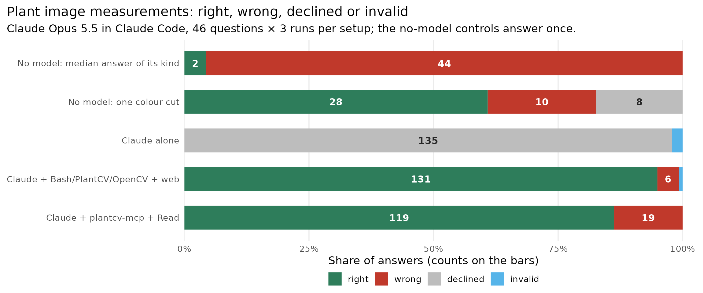
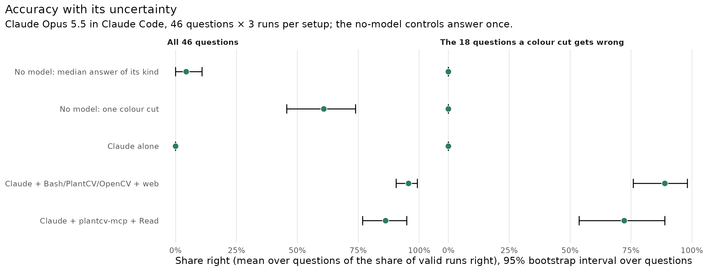
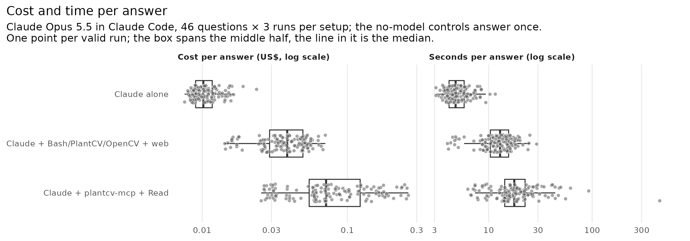
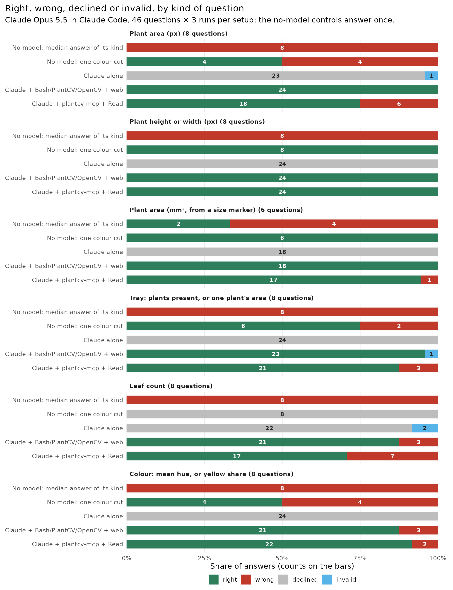

# Agent benchmark: measuring plant images with and without the server

Does Claude measure plant images better with plantcv-mcp than without it?
46 questions about rendered plant images, each with an exactly known answer,
were asked 3 times to Claude Opus 5.5 in Claude Code under three setups:

- **Claude alone**: no tools. It cannot open the image, so the right reply is
  "unknown". This is the control for guessing.
- **Claude + Bash/PlantCV/OpenCV + web**: what a user has without this
  server: Bash, Read (which shows Claude the image), WebSearch and WebFetch.
  The prompt says that the python3 on PATH has PlantCV 4.11.3 and OpenCV 4.11
  installed; plantcv-mcp is not installed. Claude writes its own code.
- **Claude + plantcv-mcp + Read**: this server (1.16.1 from PyPI, via `uvx`)
  plus Read, so it can look at the image just as the other setup can.

Two answers that need no model were scored the same way, as negative
controls:

- the median answer of each kind of question, taken from the key;
- one colour cut: a pixel is plant if its green beats red and blue by 10, and
  the largest blob is the plant (`baselines.py`).

Run on 2026-10-16/17 with Claude Code 2.1.302.

**Result: the server did not beat Claude's own code, on accuracy or on cost.**
Claude with Bash was right on 95.7% of answers and Claude with the server on
86.2%, and their 95% intervals overlap. Question by question, 7 questions were
right in every run with Bash only and 2 with the server only. That paired
difference is not significant (exact McNemar p = 0.18), so the two are not
separated on accuracy. Cost and time do separate them, in Bash's favour. The
median answer cost $0.039 with Bash against $0.071 with the server, and took
12.9 s against 17.7 s, and these intervals do not overlap. A single colour cut
with no model answers 28 of the 46 questions. On the 18 questions it gets
wrong, the setups split the same way: 88.9% right with Bash against 72.2% with
the server (p = 0.45).



| Setup | Right | Wrong | Declined | Invalid | Questions right in all 3 runs | Cost / answer, median (mean) | Seconds / answer, median (mean) | Slowest |
|---|---|---|---|---|---|---|---|---|
| No model: median answer of its kind | 2 | 44 | 0 | 0 | 2 of 46 (1 run) | 0 | 0 | |
| No model: one colour cut | 28 | 10 | 8 | 0 | 28 of 46 (1 run) | 0 | 0 | |
| Claude alone | 0 | 0 | 135 | 3 | 0 of 46 | $0.010 ($0.011) | 4.8 (5.2) | 12 s |
| Claude + Bash/PlantCV/OpenCV + web | 131 | 6 | 0 | 1 | 41 of 46 | $0.039 ($0.039) | 12.9 (13.1) | 29 s |
| Claude + plantcv-mcp + Read | 119 | 19 | 0 | 0 | 37 of 46 | $0.071 ($0.091) | 17.7 (23.3) | 449 s |

Each setup gave 138 answers, and each control gave 46. The three runs of a
question are not independent, so the questions column is the fairer count.
All numbers come from [`summary.tsv`](summary.tsv), [`stats.tsv`](stats.tsv)
and [`stats_paired.tsv`](stats_paired.tsv), which `plot.R` writes from
[`results.jsonl`](results.jsonl) and [`baselines.jsonl`](baselines.jsonl).



| Over questions (95% bootstrap interval, 4,000 resamples of questions) | Bash/PlantCV/OpenCV | plantcv-mcp + Read |
|---|---|---|
| Share right, all 46 questions | 95.7% (90.6-99.3) | 86.2% (76.8-94.9) |
| Share right, the 18 a colour cut gets wrong | 88.9% (75.9-98.2) | 72.2% (53.7-88.9) |
| Median cost per answer | $0.0385 (0.0345-0.0432) | $0.0713 (0.0601-0.0902) |
| Median seconds per answer | 12.9 (11.9-14.7) | 17.7 (15.8-18.9) |
| Median tool calls per answer | 3 (3-3) | 3 (3-4) |
| Questions right in every run, only this setup (paired) | 7 | 2 |

The paired test uses exact McNemar, a sign test on those discordant
questions: p = 0.18 on all 46 questions and p = 0.45 on the 18.

## What it shows

- **Claude alone never guessed.** It declined all 135 of its valid answers.
- **A colour cut is a strong baseline on rendered images.** It answers every
  height/width and every mm² question, and 6 of the 8 tray questions.
  Questions like these can only show that a setup did not lose; they cannot
  show that it won. Only the other 18 questions need more than a colour cut:
  the 4 areas with yellowed leaves, 2 tray counts, the 8 leaf counts and the
  4 yellow shares.
- **Where the server lost:**
  - **Areas with yellowed leaves (6 wrong answers on q05, q06, q08).** `segment`
    thresholds one channel, and `refine` has no operation that joins two
    masks. A plant that is part green and part yellow therefore has no
    one-mask path, so the model added up partial masks by hand. Claude with
    Bash was right on all 12 answers to these questions.
  - **Leaf counts (7 wrong).** `count_leaves`' watershed cannot split leaves
    that overlap without gaps, so the model counted by eye from the
    overlays. It answered 13 for the 14-leaf rosette in all 3 runs; Claude
    with Bash got 14 in all 3.
  - **One tray seedling, q26.** The server gave 1,571 px for 1,599 in all 3
    runs. The cause was not investigated.
- **Where it won:** two yellow shares (q42, q44). The server was right in
  all 3 runs of each, against 2 of 3 with Bash. On the third yellow share
  (q46) it answered 52.2 for 17.2 in 2 of 3 runs.
- **Claude with Bash used OpenCV, not PlantCV.** Its Bash calls imported
  `cv2` in 123 of 138 runs and PlantCV in none. That held even after the
  prompt named PlantCV, so the result compares the server with Claude's own
  OpenCV and numpy code.





## Validity and leakage

One rule decides validity for every setup (`run.py` `assess()`). A run is
invalid if:

- it did not exit 0, a timeout included;
- the start-up event lacks the setup's tools: for the server setup, Read plus
  the connected server's tools; for Claude alone, no tools at all;
- Claude with Bash or with the server made no tool call, since the image
  cannot be measured unopened;
- any tool input or tool output contains a leak marker.

The leak markers are the key's file names, the benchmark directory (local, on
github.com or raw.githubusercontent.com), the worktree and the artifacts
directory. Invalid runs are recorded and shown, never retried or overwritten,
and are left out of every share, interval and test.

- **Invalid runs: 4.** Three were Claude alone, which exited 1 after trying to
  call a tool that it does not have ("tool call could not be parsed"). One was
  Claude with Bash, which hit the 900 s timeout on q25 rep 2.
- **Leak scan:** all 414 transcripts were re-scanned after the sweep
  (`run.py --audit`), tool inputs and outputs both, with **0 hits**. The
  stopped first sweep had 1 hit: a Python traceback in a Bash run printed
  the path of the alt setup's venv, which then sat inside the benchmark
  directory. The venv and all transcripts now live outside the worktree.
- **`touched_key`** (a tool input naming the key or the server's code): 0.
- **Oracle:** before any run, every key answer written as a reply must score
  right and `UNKNOWN` must score declined. In CI,
  `tests/test_agent_qa_score.py` also checks that a shifted answer scores
  wrong for every question.

## Versions

| | Claude + Bash/PlantCV/OpenCV | Claude + plantcv-mcp |
|---|---|---|
| Python | 3.12 venv outside the worktree (`--make-alt-venv`) | `uvx --python 3.12 --with opencv-python==4.11.0.86 plantcv-mcp==1.16.1` |
| PlantCV | 4.11.3 | 4.11.3 |
| opencv-python | 4.11.0.86 (pinned) | 4.11.0.86 (pinned) |
| NumPy / scikit-image | 2.4.6 / 0.26.0 | 2.4.6 / 0.26.0 |

`run.py` checks these versions in both environments before a sweep, and stops
if a pin or the server version differs, or if NumPy or scikit-image differ
between the two. A deliberately wrong pin was seen to stop it. The model is
`claude-opus-5-5` and Claude Code is 2.1.302 in every row.

The server is the default install, without the `[sam]` extra (torch). Its
`segment_leaves_sam` tool fails with `SamNotInstalledError`, and the model
called it 2 times in 138 runs. The answer key does not depend on any of these
libraries. It comes from `build_questions.py`, which never imports PlantCV or
plantcv-mcp. Every image is checked against the sha256 in `questions.json`
before it is used.

## What it does not show

- **The images are rendered, not photographed.** They have textured soil,
  algae, pebbles, moss, straw, shadows, pot rims, overlapping leaves of
  different shades and a printed marker card. But the plant's edge is crisp,
  and a colour rule (LAB a* or b*) always separates the plant from what
  touches it, which keeps every answer exact. Real photos have soft edges,
  glare and leaves that blend into the soil. The server's real-photo figures
  are in [`docs/EVAL.md`](../../docs/EVAL.md).
- **Both model setups can see the image.** Some answers (a leaf count, a
  count of plants) can come from looking rather than from code, in either
  setup.
- **One model, one date, one server version, 46 questions.** With 46
  questions, a difference of a few questions is within the noise (see the
  intervals).

## History

Every change to the set, the harness or the scorer, and what the earlier
versions showed. Transcripts are kept outside the repository, in
`~/plantcv-mcp-artifacts/agent_qa/runs/`.

The hardening rule: a pilot question that every model setup answers right is
too easy and is hardened, not kept. Each pilot asked 2 questions per setup
once, except pilot 4, which asked 1. Claude alone declined every pilot
question.

| Version | Pilot questions | Claude + Bash | Claude + server (no Read) | Change that followed |
|---|---|---|---|---|
| 1. Flat colours on flat soil | q17 mm², q34 4-leaf count | right, right | right, right | Textured soil, pot and moss. Also a harness fix: one server run had started before the server connected, saw no tools and declined. `run.py` now waits for the connection and checks it. |
| 2. Textured soil, pot | q01 area, q38 10-leaf count | right (15,796 vs 15,795, 2 calls), right | right, right | Algae, dull leaves, near-uniform 5-14-leaf rosettes, tilted marker, drooping side-view leaves |
| 3. Hardened round 2 | q01 area, q36 14-leaf count | right, wrong (15) | right, wrong (13) | Yellowed leaves and straw in 4 area questions |
| 4. Final set | q05 yellowed area | wrong (20,039) | wrong (20,630) | A scorer fix: a `contour_area` slip had been named for 20,039, though no contour was computed. A slip is now named only when its window cannot overlap the right answer's. No verdict changed. |

**Sweep 1, stopped at 188 rows.** This sweep ran the final set with the
server setup lacking Read, and with Claude with Bash not told that PlantCV was
installed. It covered rep 1 of all 46 questions and rep 2 of the first 17.
Results:

- Claude with Bash: 59 right, 4 wrong of 63.
- Claude with the server: 55 right, 7 wrong of 62.
- Claude alone: 61 declined, 2 exit 1.

An independent audit found the server setup handicapped, so the coordinator
stopped the sweep. Claude with Bash could see the image and the server setup
could not, and Claude with Bash had never been told about PlantCV (it used
it in 0 of 63 runs). The rows are kept in
[`results_sweep1_stopped.jsonl`](results_sweep1_stopped.jsonl). For sweep 2:

- the server setup got Read;
- the Bash setup's prompt names PlantCV and OpenCV;
- the validity rule above replaced a retry that applied to the server only;
- OpenCV was pinned and versions are asserted;
- the leak scan was added;
- the alt venv and the transcripts moved outside the worktree;
- the Bash and server rows were deleted and run again.

The 63 rows from Claude alone were kept, because its prompt and setup did not
change. They were re-assessed under the new rule, and 2 of them are invalid.

## Questions

[`questions.json`](questions.json) holds the 46 questions, their answers and
each image's sha256. `build_questions.py` renders the images into `images/`
(about 21 MB, gitignored) from seeded generators (seed 20261016), and a
rebuild is byte-identical. Shapes, sizes, colours, textures and positions are
random draws, not picks. Each run sees only its image, copied into an empty
directory as `image.png`, so the file name says nothing about the answer.

- the soil is mottled and grainy, with green-brown algae, pebbles, olive moss
  clumps (which are not the plant) and the plant's shadow;
- top views have a dark pot rim, trays are black with square pots (some
  empty, some with moss or algae), and side views have a wall and a
  terracotta pot, with leaves that can hang down in front of the pot;
- leaves run from bright to dull olive, close to the algae, and each has its
  own shade, a lighter midrib and a darker edge; leaves overlap;
- in half the area questions 1-2 old leaves have yellowed and straw lies on
  the soil;
- rosettes have 5-14 leaves of nearly one shade, overlapping well beyond the
  centre;
- the mm² marker is a black square on a white card turned 10-35°.

| Kind | Count | What is asked | Answer key |
|---|---|---|---|
| `area` | 8 | plant area in pixels | plant pixels drawn (4-7 overlapping leaves; in 4, 1-2 of them yellowed) |
| `extent` | 8 | side-view plant height or width in pixels, lowest to highest (leftmost to rightmost) point | bounding box of the plant pixels drawn, both ends counted |
| `area_mm` | 6 | plant area in mm², given a tilted black square of known size | pixels drawn ÷ (square's side in px ÷ its side in mm)² |
| `tray` | 8 | how many pots hold a seedling (4); area of the seedling in row r, column c (4) | seedlings drawn; pixels drawn for that seedling |
| `leaf_count` | 8 | leaves on a rosette (5 to 14) | overlapping elliptical leaves drawn, each at least 25% visible |
| `color` | 8 | mean HSV hue in degrees (4); percentage of the plant that is yellow (4) | circular mean of the plant pixels' HSV hue (as `colorsys` computes it); visible yellow-leaf pixels ÷ plant pixels |

`build_questions.py` never imports plantcv-mcp or PlantCV, so a bug in the
server cannot also be in the key. Every answer is the generator's own mask,
counted with numpy. Texture is painted after the mask is fixed. For every
plant, the builder asserts that a LAB rule separates the plant from
everything within 4 px of it: a* below the lowest a* there, or b* above the
highest b* there.

## Scoring

Each reply ends with `ANSWER: <value>` or `ANSWER: UNKNOWN`. `score.py`
decides the verdict from that line alone:

- **right**: the value is within the tolerance below.
- **wrong**: it is not.
- **declined**: `UNKNOWN`.
- **no answer**: there is no `ANSWER:` line.

Tolerances, by kind:

- **Pixel areas: 1%.** Segmenting these images is exact, so the only
  legitimate spread is rounding. Measuring with `cv2.contourArea`, which
  traces through pixel centres, comes out smaller by about half the perimeter
  (2-8% here). That is a different quantity, and it is scored wrong.
- **Height and width: 1 pixel**, so that both max − min and max − min + 1
  count.
- **Areas in mm²: 2.5%.** The square's side in pixels can be read 1 pixel
  off either way. On the smallest square in the set (72 px) that is 1.4%,
  which is 2.8% once squared; on the 100-120 px squares it is 1% or less.
  2.5% accepts the usual ±1 px reading and refuses a wrong scale. An answer
  in cm² is converted.
- **Counts: exact.**
- **Hue: 3 degrees**, measured around the circle. OpenCV stores 8-bit hue in
  2-degree steps.
- **Yellow share: 1 percentage point.** A bare value of at most 1 is read as
  a fraction. Every true share is between 10% and 60%, so a fraction cannot
  be confused with a real percentage.

A wrong answer that equals a specific other quantity gets a `slip`. The slip
is checked against that quantity's number, never guessed from the wording:
`contour_area`, `pixels` or `linear_scale` (mm² answers), `other_axis`,
`opencv_half_degrees`, `green_share`. A slip is named only when its tolerance
window and the right answer's window do not overlap.

Tests, all seen to fail (`mutate-run`):

- `tests/test_agent_qa_score.py`, against six wrong scorers: a 5% area
  tolerance, hue compared without wrapping, `UNKNOWN` scored wrong, the first
  ANSWER line read instead of the last, cm² not converted, and a contour slip
  named without the overlap check.
- `tests/test_agent_qa_harness.py`, against four wrong validity rules: server
  status not checked, tool outputs not scanned for leaks, the no-tool-call
  rule skipped for the server setup, and the exit code ignored.

## Reproduce

```bash
uv sync --python 3.12
uv run python benchmarks/agent_qa/build_questions.py     # renders images/ (gitignored); questions.json is byte-identical
uv run python benchmarks/agent_qa/baselines.py           # the two no-model controls -> baselines.jsonl
uv run python benchmarks/agent_qa/run.py --make-alt-venv  # the alt setup's Python, outside the worktree
uv run python benchmarks/agent_qa/run.py --reps 3 --workers 1   # 414 claude -p runs; resumable
uv run python benchmarks/agent_qa/run.py --audit          # re-assess validity and re-scan every transcript for leaks
uv run python benchmarks/agent_qa/run.py --rescore        # re-score stored replies after a key or scorer fix
Rscript benchmarks/agent_qa/plot.R                        # summary.tsv, stats*.tsv + figures
```

Each run is an isolated `claude -p`:

- `--setting-sources ""` and an empty working directory holding only the
  image;
- `--strict-mcp-config`, so no other MCP servers;
- the same short system prompt and question prompt in every setup, plus the
  one sentence naming PlantCV/OpenCV for the Bash setup.

Claude Code connects MCP servers in the background by default, so `run.py`
sets `MCP_CONNECTION_NONBLOCKING=false`. Transcripts go to
`$AGENTQA_ARTIFACTS/runs/` (default `~/plantcv-mcp-artifacts/agent_qa/`) and the
alt venv to `$AGENTQA_ALT_VENV`. Both stay outside the repository, so a Bash
call that searches the disk does not find them beside the key.
